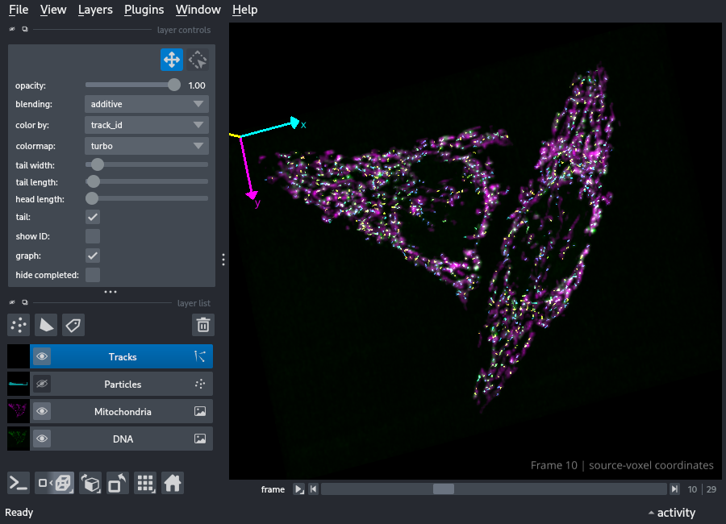

# Rendering biological data with napari

This repository contains the materials for **napari Workshop Datasets: Deciphering the Living Cell through Microscopy and Computation**, a three-hour workshop for biologists on November 16–17, 2026.

You will use a Jupyter notebook and a separate napari window to explore a four-dimensional microscopy dataset. You will load two image layers, **DNA** and **mitochondria**, add particle detections and tracks, adjust the display, and export a view. The detections and tracks are already computed, so we can focus on viewing and interpreting them.

## Start here

Complete these steps before the workshop if possible:

1. Follow the instructions for [Windows](setup/windows.md) or [macOS](setup/macos.md).
2. [Download the teaching data](setup/download-data.md).
3. Open `notebooks/00_check_setup.ipynb` in JupyterLab and run its checks.
4. If something differs from the expected result, use [troubleshooting](setup/troubleshooting.md) or send the instructor the exact error text.

On the workshop day, start in the extracted `napari-workshop` folder and run:

```console
uv run jupyter lab
```

Open `notebooks/01_rendering_workshop.ipynb`. Choose **Kernel → Change Kernel… → Python (napari workshop)** if that name is not already shown at the upper right. Run cells from top to bottom. JupyterLab stays in the browser; napari opens in its own desktop window.

## Materials

- [Download and data guide](setup/download-data.md)
- [Troubleshooting](setup/troubleshooting.md)
- [One-page quick reference](handouts/quick-reference.md)
- [Glossary](handouts/glossary.md)
- [Exercises](handouts/exercises.md)
- [Use your own data](handouts/use-your-own-data.md)
- [Instructor teaching guide](instructor/teaching-guide.md)
- [Slide outline](instructor/slide-outline.md)

The optional notebooks explore animation and ways to load a larger dataset without holding it all in memory. You can work through them after class.

## Reference view



This view shows frame 10 of the teaching data. The layer list and controls are on the left, the image is in the main canvas, and the frame slider is at the bottom. Compare it with the [2D projection](reference/viewer-2d-interface.png) to see how the same data look when depth is flattened.

## What the data represent

The source data contain 30 frames per image channel. Each source image volume is `118 × 664 × 860` voxels with unsigned 16-bit intensity values. The complete two-channel image series occupies about 7.53 GiB before Python and graphics memory are counted. The 42.8 MB teaching ZIP keeps all 30 frames and reduces each spatial dimension by a factor of four; the extracted image arrays contain about 122.5 MiB. This makes it practical to display, but fine spatial detail has been lost and cannot be recovered from the prepared files.

Positions are given in source voxels, and frames are numbered `0` through `29`. We still need to confirm the voxel size and acquisition interval before converting these to micrometres and seconds. The file `detections.csv` contains `t,z,y,x,amp,int`; `tracks.csv` contains `id,t,z,y,x` and 2,058 track IDs. Each point marks a possible particle, and each track links positions across frames. Both can contain errors and need to be checked against the images.

Teaching dataset: [Spatially Downsampled Images, Detections, and Tracks](https://doi.org/10.5281/zenodo.22696913). Original dataset: [napari Workshop Datasets: Deciphering the Living Cell through Microscopy and Computation (2026)](https://doi.org/10.5281/zenodo.22694247), licensed [CC BY 4.0](https://creativecommons.org/licenses/by/4.0/). The new workshop code is licensed under the BSD 3-Clause License.

## Requirements and status

Use Windows or macOS, about 10 GB of free disk space, and preferably 16 GB of RAM; 8 GB is the intended minimum for the prepared teaching package. A dedicated NVIDIA GPU is not required, but napari still needs working graphics/OpenGL support.

Run the setup notebook before class to check the viewer and movie export on your computer. If a check fails, send the instructor your operating system, processor, and the complete error message.

Read the [online walkthrough](https://thedeanlab.github.io/napari-workshop/) or download the [course ZIP](https://github.com/TheDeanLab/napari-workshop/releases/download/v0.1.2/napari-workshop-v0.1.2.zip) and [offline HTML handouts](https://github.com/TheDeanLab/napari-workshop/releases/download/v0.1.2/napari-workshop-handouts.zip). See the [validation record](instructor/validation-report.md) for tested behavior and remaining platform checks.
