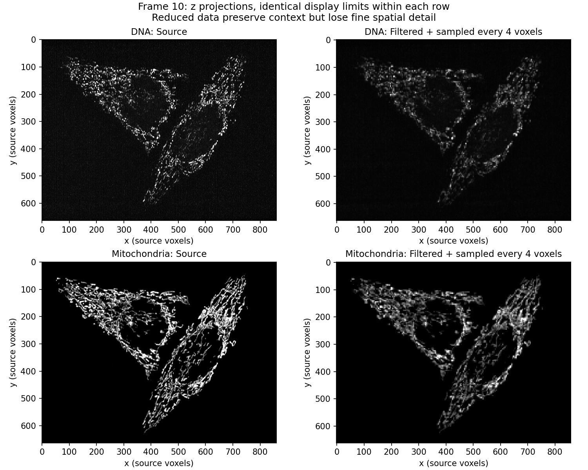

# Workshop data

Original dataset: [Fiolka and Dean (2026), Zenodo 22694247](https://doi.org/10.5281/zenodo.22694247), CC BY 4.0. The published record has 60 TIFF stacks, detections.csv, tracks.csv, and a MATLAB metadata file. The workshop does not require MATLAB.

Run `uv run scripts/download_data.py --dataset teaching` from the workshop root. This downloads the **42.8 MB** prepared teaching ZIP from the v0.1.0 GitHub release and extracts it into `data/teaching`. It retains all 30 timepoints and both channels. This derivative is hosted with the course temporarily; a future downsampled Zenodo record can replace that download endpoint while retaining provenance.

The original data remain on Zenodo. `uv run scripts/download_data.py --dataset source --timepoints 5 --dry-run` reports the files and transfer size for a short original-resolution sequence. Remove `--dry-run` to download it. Thirty timepoints require approximately 8.1 GB. The checked-in manifests specify exact sizes and checksums; the downloader verifies them.

## Extracted teaching layout

```text
data/teaching/
  metadata.json
  detections.csv
  tracks.csv
  ch0/frame_000000.tif ... frame_000029.tif
  ch1/frame_000000.tif ... frame_000029.tif
```

Each TIFF is uint16, shape **30 × 166 × 215**, axis order **z,y,x**. Stacking the files produces **t,z,y,x**. The original shape is **118 × 664 × 860**. The prepared images were Gaussian filtered (sigma 1.5 source voxels, reflect boundaries), sampled at indices 0,4,8,... along each spatial axis, then rounded to uint16. This reduces fine spatial detail; it is not a new measurement or a quantitatively interchangeable image.

The sampled voxel centers remain at their original coordinates. The coarse outer image footprint can differ by less than half a coarse voxel from the original boundary; we do not stretch the image to force equal outer edges. All supplied detections and tracks are inside the displayed teaching-image bounds. For your own data, inspect edge observations as well as central ones. This method is suitable for teaching visualization, not measuring exact specimen boundaries from reduced images.



Detections are a headered table: `t,z,y,x,amp,int`. Tracks are a headerless numeric table: `track_id,t,z,y,x`. Original rows and coordinates are preserved. There are 28,105 detections, 25,076 track rows, and 2,058 track IDs. The prepared image scale is four source voxels per displayed voxel; point and track coordinates still use the original source grid. Do not multiply those coordinates by four again.

Spatial calibration and the time interval await confirmation. Current lessons use **source voxels** and **frame indices**; no micrometre scale bar or experimental seconds are claimed. The source notebook's channel names are DNA and Mitochondria. Its detections and tracks are precomputed observations/associations, not a curated ground-truth benchmark.

`metadata.json` in the prepared package records the method, source DOI, counts, and per-file SHA-256 checksums. The repository's `zenodo-manifest.json` records the source-file MD5 checksums returned by Zenodo. All source inputs were checksum-verified when preparing this release.

The Python entry-point scripts are part of the complete workshop folder and reuse the neighboring `src/napari_workshop` code. Download the full course ZIP rather than an individual script. Each script's PEP 723 metadata and companion lockfile describe its isolated dependencies; the notebook uses the persistent environment recorded in the project `uv.lock`.
