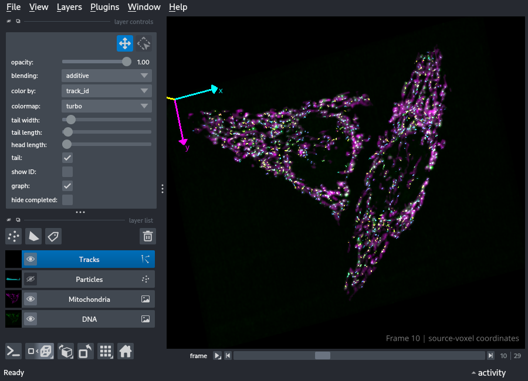

# Rendering biological data with napari

Welcome to the online handouts for **napari Workshop Datasets: Deciphering the Living Cell through Microscopy and Computation**, November 16–17, 2026.

This three-hour workshop is written for biologists with little or no programming experience. Start with your operating system setup page before class. During class, the main notebook takes you from an image array to a deliberately styled view with supplied detections and tracks, then to a saved PNG or short movie.

[Download the course files](https://github.com/TheDeanLab/napari-workshop/releases/download/v0.1.0/napari-workshop-v0.1.0.zip) · [Download offline HTML handouts](https://github.com/TheDeanLab/napari-workshop/releases/download/v0.1.0/napari-workshop-handouts.zip)

JupyterLab opens in a browser and runs the explanatory notebook. Napari opens in a separate desktop window on the same computer. Opening this website alone cannot launch that local Qt viewer.



The reference above is a real render of the prepared course data at frame index 10. A [matching 2D projection](../reference/viewer-2d-interface.png) supports the fallback route. These images were produced during Linux validation and do not claim a successful Windows or macOS platform test.

{download}`Download the reference time-series MP4 <../reference/time-series.mp4>` (30 acquisition frames, displayed at 10 playback frames per second; source data CC BY 4.0).

```{admonition} Scientific boundary
The points and tracks are precomputed. The workshop displays and interprets them; it does not run new detection or tracking. Coordinates remain source voxels and time remains a frame index because physical calibration and acquisition timing are not yet confirmed.
```

```{toctree}
:maxdepth: 2
:caption: Begin

../README
../setup/windows
../setup/macos
../setup/download-data
../setup/troubleshooting
```

```{toctree}
:maxdepth: 2
:caption: Workshop notebooks

../notebooks/00_check_setup
../notebooks/01_rendering_workshop
../notebooks/02_optional_animation
../notebooks/03_optional_large_data
```

Notebook source files:

- {download}`Download the setup notebook <../notebooks/00_check_setup.ipynb>`
- {download}`Download the main workshop notebook <../notebooks/01_rendering_workshop.ipynb>`
- {download}`Download the optional animation notebook <../notebooks/02_optional_animation.ipynb>`
- {download}`Download the optional large-data notebook <../notebooks/03_optional_large_data.ipynb>`

```{toctree}
:maxdepth: 2
:caption: Student handouts

../handouts/quick-reference
../handouts/glossary
../handouts/exercises
../handouts/use-your-own-data
```

```{toctree}
:maxdepth: 2
:caption: Instructor materials

../instructor/teaching-guide
../instructor/slide-outline
../instructor/solutions
../instructor/validation-report
```

The dataset is available through DOI [10.5281/zenodo.22694247](https://doi.org/10.5281/zenodo.22694247) under CC BY 4.0. The main teaching package is a factor-4 spatial derivative that keeps all 30 frames and loses fine detail. Use [Download the data](../setup/download-data.md) for the verified course route.
